# MultiEnv Ticket Management System: Local Docker Deployment

Multi-environment ticket management application deployed locally with Docker and Docker Compose. It has a React frontend and two Flask backends (development and production), each connected to its own MongoDB database.

## Table of Contents

1. [Architecture](#1-architecture)
2. [Access URLs and Ports](#2-access-urls-and-ports)
3. [Infrastructure Setup (Local Environment)](#3-infrastructure-setup-local-environment)
4. [Docker Configuration](#4-docker-configuration)
5. [Application Deployment](#5-application-deployment)
6. [Testing and Verification](#6-testing-and-verification)
7. [Evidence Index](#7-evidence-index)
8. [Assumptions and Limitations](#8-assumptions-and-limitations)
9. [Design Notes for VIVA](#9-design-notes-for-viva)

---

## 1. Architecture

```
                        Browser (localhost)
                               |
        +----------------------+----------------------+
        |                      |                      |
   :3000 frontend         :3001 backend-dev      :3002 backend-prod
   (React + nginx)        (Flask, debug)         (Flask + gunicorn)
        |                      |                      |
        |  /dev, /prod         |                      |
        +--- axios calls ------+----------------------+
                               |                      |
                    host.docker.internal:27017 (MongoDB on host)
                               |                      |
                        tickets_dev            tickets_prod
```

| Component | Technology | Container | Host Port |
|---|---|---|---|
| Frontend | React 19 (CRA), served by nginx | `frontend` | 3000 |
| Development backend | Flask, Flask-PyMongo, Flask-CORS | `backend-dev` | 3001 |
| Production backend | Flask served by gunicorn | `backend-prod` | 3002 |
| Database | MongoDB 6.0 (local, Homebrew) with Compass | host | 27017 |

All three containers join a user-defined bridge network, `appnet`.

---

## 2. Access URLs and Ports

| Purpose | URL |
|---|---|
| Frontend dashboard | http://localhost:3000/ |
| Development environment | http://localhost:3000/dev |
| Production environment | http://localhost:3000/prod |
| Dev backend UI | http://localhost:3001/ |
| Dev backend API | http://localhost:3001/api/tickets |
| Prod backend UI | http://localhost:3002/ |
| Prod backend API | http://localhost:3002/api/tickets |

---

## 3. Infrastructure Setup (Local Environment)

A local environment was used instead of EC2. A host firewall and selective port publishing replace security groups.

### 3.1 Environment specifications

| Item | Value |
|---|---|
| Host | MacBook (Apple Silicon, arm64), macOS |
| Container runtime | Docker Desktop (Linux VM, kernel 5.15 linuxkit) |
| Docker / Compose | Docker Desktop with Compose v2 (`docker compose`) |
| Database | MongoDB Community 6.0.5 (Homebrew) + MongoDB Compass |
| Project path | `MultienvApp/` (cloned from GitHub) |

### 3.2 Install and verify Docker

```bash
docker --version
docker compose version
docker run --rm hello-world
```

### 3.3 Clone the repository

```bash
git clone https://github.com/tanishq-123/MultienvApp.git
cd MultienvApp
```

### 3.4 Local network setup

| Layer | Configuration |
|---|---|
| Host ports published | 3000 (frontend), 3001 (dev API), 3002 (prod API) |
| Container network | User-defined bridge `appnet` (full name `multienvapp_appnet`), with service-name DNS between containers |
| Database access | Host MongoDB reached from containers via `host.docker.internal` (mapped with `extra_hosts: host-gateway`) |
| Firewall | Docker Desktop publishes ports on localhost; no inbound rules needed for local access |

### 3.5 Database setup (MongoDB + Compass)

A single local MongoDB server hosts two isolated databases, one per environment, each with a `todos` collection.

1. Connect Compass to `mongodb://localhost:27017`.
2. Create database `tickets_dev` with collection `todos`.
3. Create database `tickets_prod` with collection `todos`.

**screenshoot#3:** `tickets_dev` and `tickets_prod` databases, each with a `todos` collection, in Compass

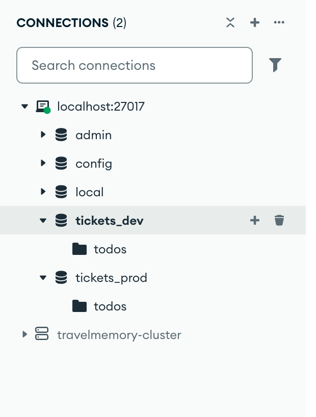

---

## 4. Docker Configuration

### 4.1 Project structure

```
MultienvApp/
├── docker-compose.yml
├── README.md
├── screenshots/
├── backend/
│   ├── dev/
│   │   ├── app.py
│   │   ├── requirements.txt
│   │   ├── Dockerfile
│   │   ├── .dockerignore
│   │   └── .env
│   └── prod/
│       ├── app.py
│       ├── requirements.txt
│       ├── Dockerfile
│       ├── .dockerignore
│       └── .env
└── frontend/
    ├── src/
    ├── public/
    ├── package.json
    ├── Dockerfile
    ├── nginx.conf
    └── .dockerignore
```

### 4.2 Environment variables

`backend/dev/.env`
```
PORT=3001
MONGO_URI=mongodb://host.docker.internal:27017/tickets_dev
```

`backend/prod/.env`
```
PORT=3002
MONGO_URI=mongodb://host.docker.internal:27017/tickets_prod
```

Each backend gets its own database through `MONGO_URI`, so the environments stay isolated.

### 4.3 Backend development Dockerfile (`backend/dev/Dockerfile`)

```dockerfile
FROM python:3.11-slim
WORKDIR /app
ENV PYTHONUNBUFFERED=1
COPY requirements.txt .
RUN pip install --no-cache-dir -r requirements.txt
COPY . .
EXPOSE 3001
CMD ["python", "app.py"]
```

Runs the Flask development server with debug mode and auto-reload, for fast iteration.

### 4.4 Backend production Dockerfile (`backend/prod/Dockerfile`)

```dockerfile
FROM python:3.11-slim
WORKDIR /app
ENV PYTHONUNBUFFERED=1
COPY requirements.txt .
RUN pip install --no-cache-dir -r requirements.txt gunicorn
COPY . .
RUN useradd -m appuser && chown -R appuser /app
USER appuser
EXPOSE 3002
CMD ["gunicorn", "-b", "0.0.0.0:3002", "-w", "2", "--access-logfile", "-", "app:app"]
```

Runs gunicorn (a production WSGI server) with 2 workers, as a non-root user, with access logging to stdout.

### 4.5 Frontend Dockerfile (`frontend/Dockerfile`)

```dockerfile
FROM node:20-alpine AS build
WORKDIR /app
COPY package.json ./
RUN npm install --legacy-peer-deps
COPY . .
RUN npm run build

FROM nginx:alpine
COPY nginx.conf /etc/nginx/conf.d/default.conf
COPY --from=build /app/build /usr/share/nginx/html
EXPOSE 3000
```

A multi-stage build: Node compiles the React app, and the final image contains only nginx and the static build.

`frontend/nginx.conf`
```nginx
server {
  listen 3000;
  root /usr/share/nginx/html;
  index index.html;
  location / {
    try_files $uri /index.html;
  }
}
```

`try_files ... /index.html` lets client-side routes (`/dev`, `/prod`) load on direct access and refresh.

### 4.6 Frontend API configuration (`frontend/src/pages/Tickets.js`)

The API host is derived from the browser's location, so the same build works on `localhost` and on any other host:

```js
const host = window.location.hostname;
const apiUrl = env === "dev"
  ? `http://${host}:3001/api/tickets`
  : `http://${host}:3002/api/tickets`;
```

### 4.7 `.dockerignore` files

`frontend/.dockerignore`
```
node_modules
build
```

`backend/dev/.dockerignore` and `backend/prod/.dockerignore`
```
.env
__pycache__
```

### 4.8 Docker Compose (`docker-compose.yml`)

```yaml
services:
  backend-dev:
    build: ./backend/dev
    container_name: backend-dev
    env_file: ./backend/dev/.env
    ports:
      - "3001:3001"
    extra_hosts:
      - "host.docker.internal:host-gateway"
    volumes:
      - ./backend/dev:/app
    networks: [appnet]

  backend-prod:
    build: ./backend/prod
    container_name: backend-prod
    env_file: ./backend/prod/.env
    ports:
      - "3002:3002"
    extra_hosts:
      - "host.docker.internal:host-gateway"
    restart: unless-stopped
    networks: [appnet]

  frontend:
    build: ./frontend
    container_name: frontend
    ports:
      - "3000:3000"
    depends_on:
      - backend-dev
      - backend-prod
    networks: [appnet]

networks:
  appnet:
```

| Setting | Purpose |
|---|---|
| `env_file` | Injects per-environment variables (`PORT`, `MONGO_URI`) |
| `extra_hosts` | Resolves `host.docker.internal` to the host, so containers reach local MongoDB |
| `volumes` (dev only) | Bind mount so code edits reload live under the Flask debugger |
| `restart: unless-stopped` (prod) | Production backend recovers automatically if it stops |
| `depends_on` | Starts the backends before the frontend |
| `networks: appnet` | Shared bridge network with service-name DNS |

---

## 5. Application Deployment

### 5.1 Build, start and check status

From the repository root:

```bash
docker compose up -d --build
docker compose ps
```

The build ran the frontend multi-stage steps (`npm install`, `npm run build`, copy into nginx), created the `multienvapp_appnet` network, and started all three containers.

| Container | Image | Command | Status | Ports |
|---|---|---|---|---|
| backend-dev | multienvapp-backend-dev | `python app.py` | Up | 0.0.0.0:3001->3001/tcp |
| backend-prod | multienvapp-backend-prod | `gunicorn -b 0.0.0.0...` | Up | 0.0.0.0:3002->3002/tcp |
| frontend | multienvapp-frontend | `/docker-entrypoint...` | Up | 0.0.0.0:3000->3000/tcp |

**screenshoot#1:** image build, network and container creation, and `docker compose ps` with all three services up

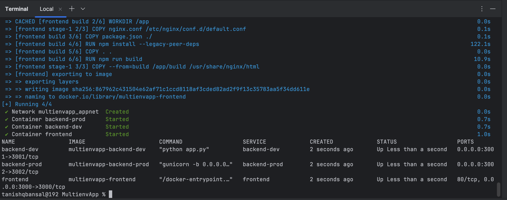

### 5.2 Service logs

```bash
docker compose logs backend-dev backend-prod
```

- `backend-prod`: gunicorn starts, listens on `http://0.0.0.0:3002`, boots 2 sync workers.
- `backend-dev`: Flask serves the app on `0.0.0.0:3001` with debug mode and the debugger active.

**screenshoot#2:** backend startup logs

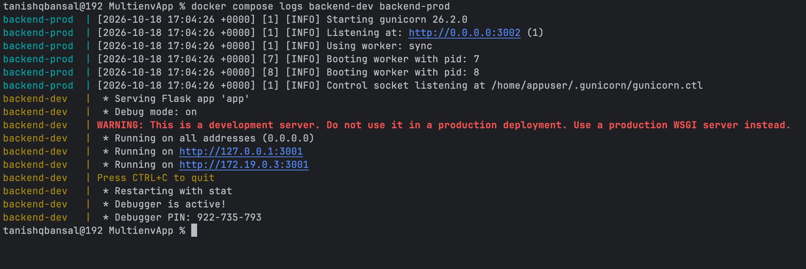

---

## 6. Testing and Verification

### 6.1 Backend API with empty collections

With both databases created and empty, each API returns an empty ticket list and identifies its environment. This confirms each backend is up and connected to its own database.

| URL | Response |
|---|---|
| http://localhost:3001/api/tickets | `{"tasks": [], "environment": "Development"}` |
| http://localhost:3002/api/tickets | `{"tasks": [], "environment": "Production"}` |

**screenshoot#6:** dev API, empty state

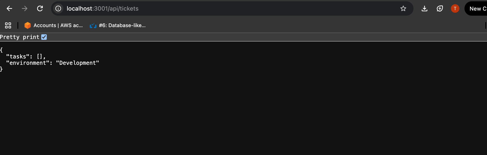

**screenshoot#5:** prod API, empty state

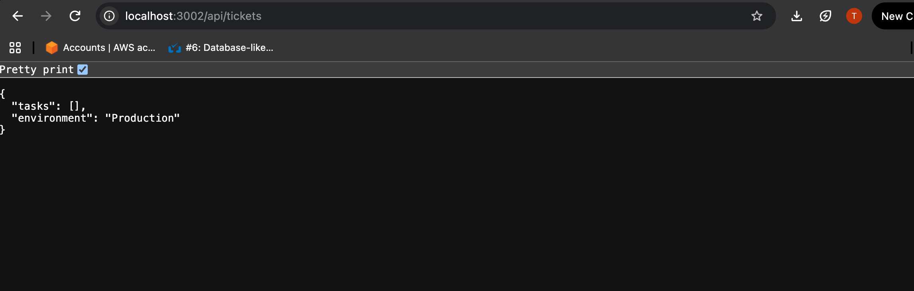

### 6.2 Seed data in MongoDB

One sample ticket was inserted into each database with Compass (Insert Document, JSON view). `created_at` is stored as a real date.

`tickets_dev.todos`
```json
{
  "title": "Fix login bug",
  "description": "Users get 500 error on login (dev)",
  "completed": false,
  "created_at": { "$date": "2026-10-18T10:00:00.000Z" }
}
```

`tickets_prod.todos`
```json
{
  "title": "Deploy v1.0 release",
  "description": "Production rollout completed (prod)",
  "completed": true,
  "created_at": { "$date": "2026-10-18T10:00:00.000Z" }
}
```

**screenshoot#10:** `tickets_dev.todos` document

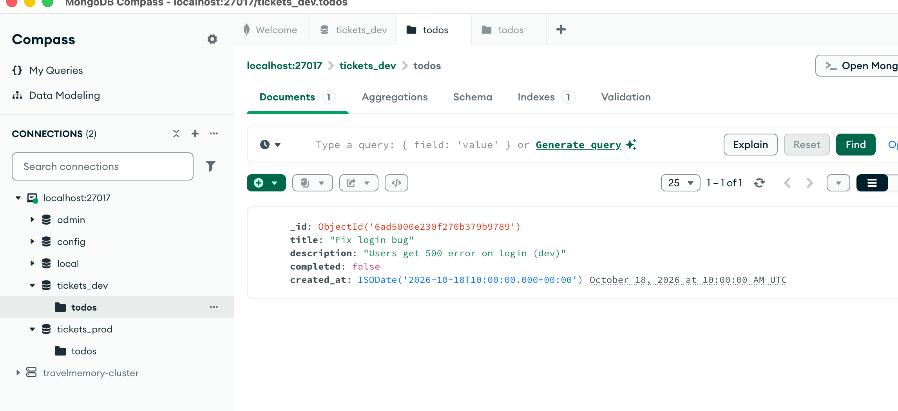

**screenshoot#7:** `tickets_prod.todos` document

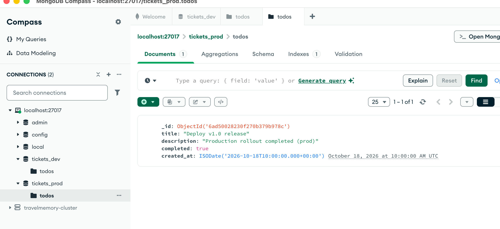

### 6.3 Backend API with data

```bash
curl -s localhost:3001/api/tickets
curl -s localhost:3002/api/tickets
```

The dev API returns the dev ticket (`"environment": "Development"`), and the prod API returns the prod ticket (`"environment": "Production"`). Different data from each endpoint confirms that each backend reads its own database.

**screenshoot#12:** dev API with data

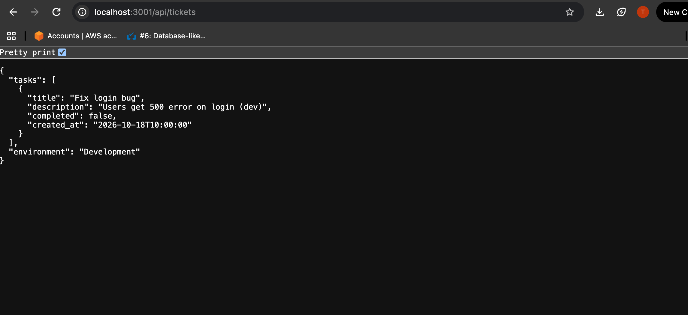

**screenshoot#11:** prod API with data

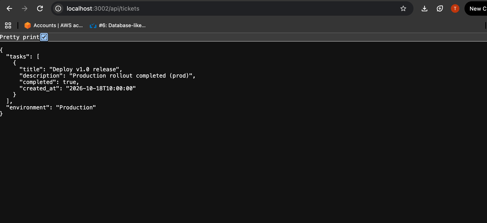

### 6.4 Frontend

| Test | URL | Result |
|---|---|---|
| Home page with environment links | http://localhost:3000/ | Loads with Development and Production buttons |
| Dev dashboard | http://localhost:3000/dev | "DEV Tickets": the dev ticket appears under Pending |
| Prod dashboard | http://localhost:3000/prod | "PROD Tickets": the prod ticket appears under Completed |

Direct access to `/dev` and `/prod` works, which confirms the nginx `try_files` fallback.

**screenshoot#4:** frontend home page

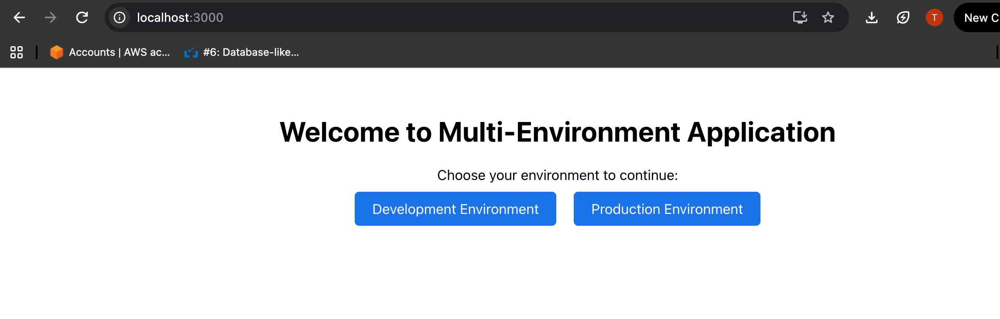

**screenshoot#9:** development dashboard

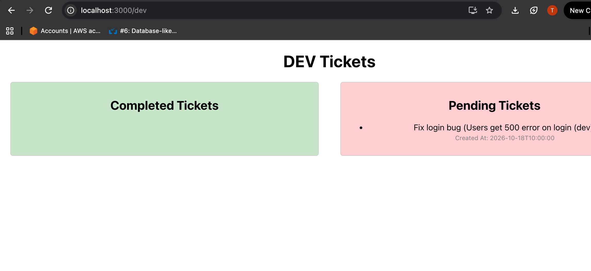

**screenshoot#8:** production dashboard

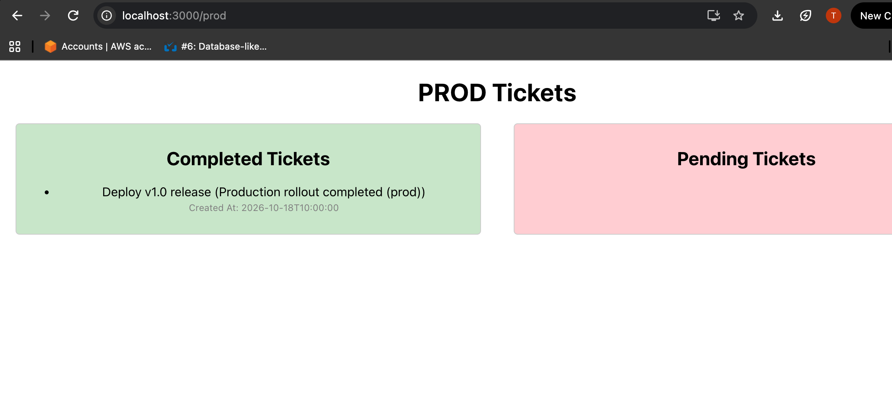

### 6.5 Backend UIs and write operations

The backend UIs at http://localhost:3001/ and http://localhost:3002/ were used to test the full create, complete and delete cycle, with MongoDB Compass checked after each step.

| Step | Operation | Route | Result |
|---|---|---|---|
| 1 | List tickets | `GET /` | 200, tickets shown with Complete and Delete buttons |
| 2 | Add ticket (dev) | `POST /add` | 302 redirect, new ticket appears in the list and in `tickets_dev.todos` (2 documents) |
| 3 | Delete ticket (dev) | `GET /delete/<id>` | Confirmation dialog, then 302 redirect; `tickets_dev.todos` is back to 1 document |
| 4 | Complete ticket (dev) | `GET /complete/<id>` | 302 redirect, ticket struck through, button changes to Undo, `completed: true` in MongoDB |
| 5 | Add tickets (prod) | `POST /add` | Tickets appear in the prod UI and in `tickets_prod.todos` (3 documents) |

Matching request lines from the `backend-dev` logs:

```
"GET /api/tickets HTTP/1.1" 200 -
"POST /add HTTP/1.1" 302 -
"GET / HTTP/1.1" 200 -
"GET /delete/6ad5014f1c782fda7fe7b1e9 HTTP/1.1" 302 -
"GET /complete/6ad5000e230f270b379b9789 HTTP/1.1" 302 -
```

**Step 1: list.** Dev backend UI with the seeded ticket

**screenshoot#13:** dev backend UI

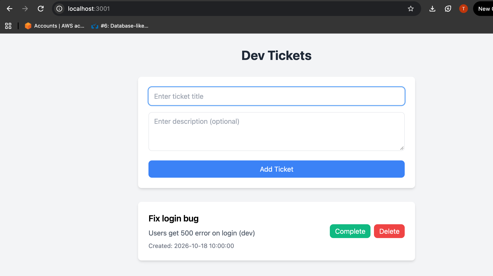

**Step 2: add.** A second ticket added through the dev UI, and the same ticket stored in MongoDB

**screenshoot#14:** dev backend UI with the new ticket listed

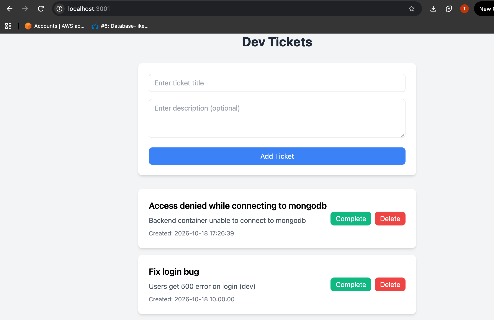

**screenshoot#15:** `tickets_dev.todos` in Compass now holds 2 documents

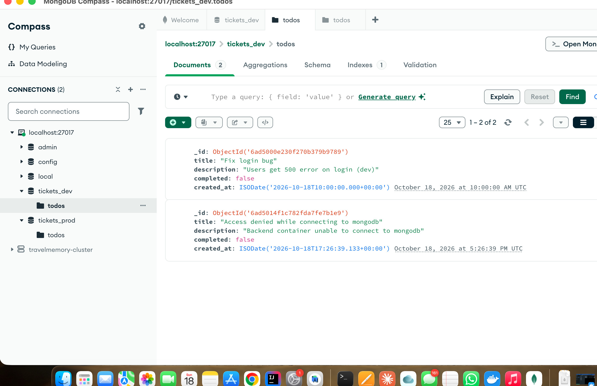

**Step 3: delete.** Delete confirmation, then the collection back to 1 document

**screenshoot#16:** delete confirmation dialog in the dev UI

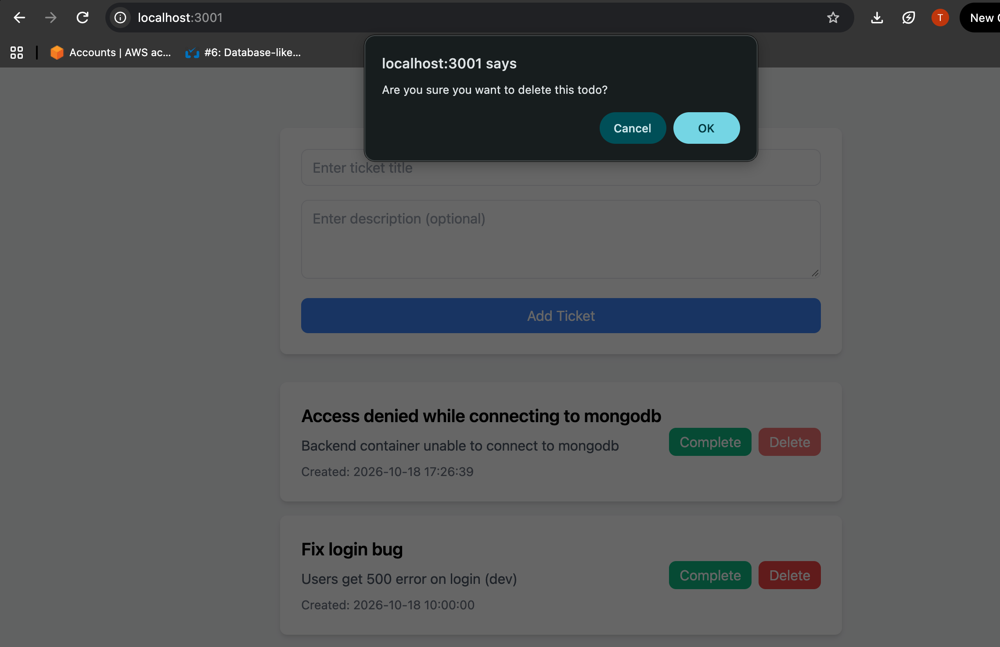

**screenshoot#17:** Compass shows 1 document left in `tickets_dev.todos` after the delete

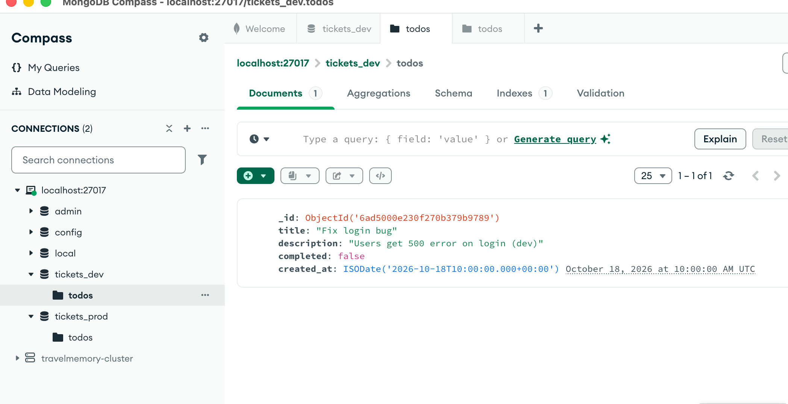

**Step 4: complete.** The remaining dev ticket marked complete

**screenshoot#18:** ticket struck through, button changes to Undo

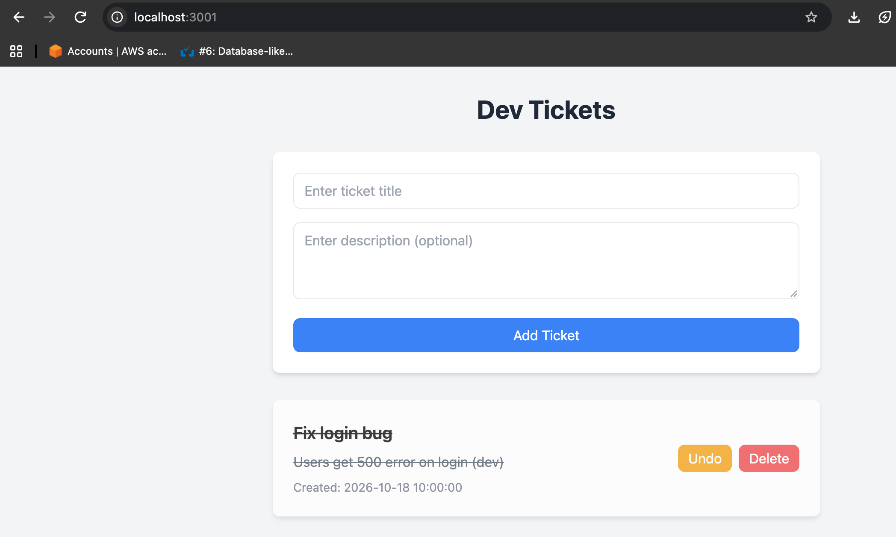

**screenshoot#19:** Compass shows `completed: true` for the same document

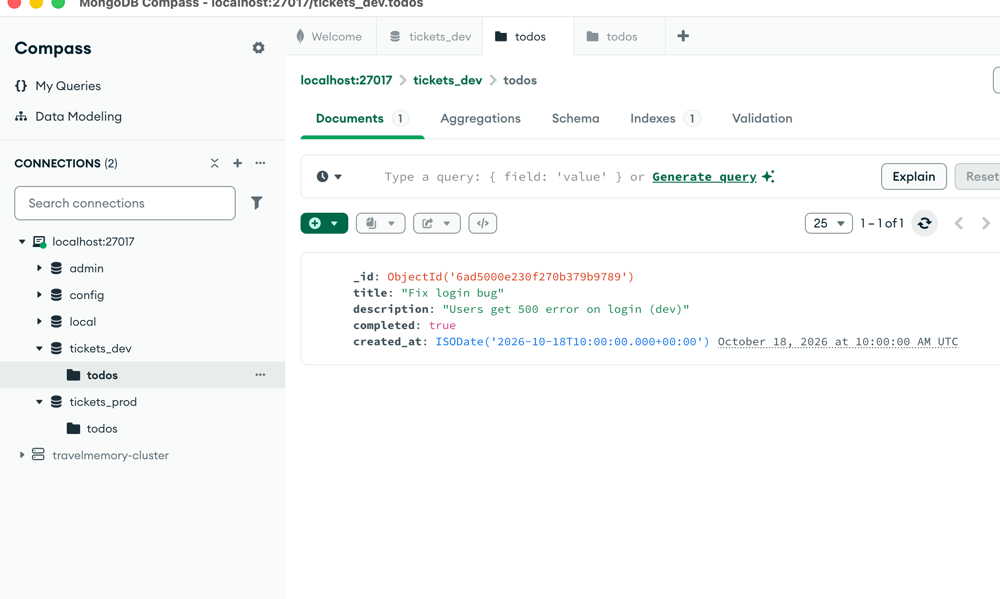

**Step 5: production.** Tickets added through the prod backend UI, and the same tickets stored in `tickets_prod.todos`

**screenshoot#20:** prod backend UI with tickets added through the UI

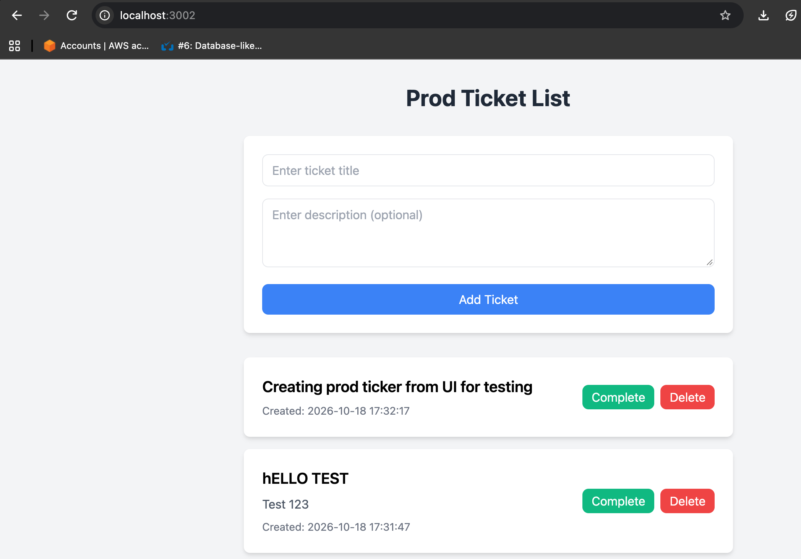

**screenshoot#21:** `tickets_prod.todos` in Compass holds 3 documents: the seed ticket plus the two added through the UI

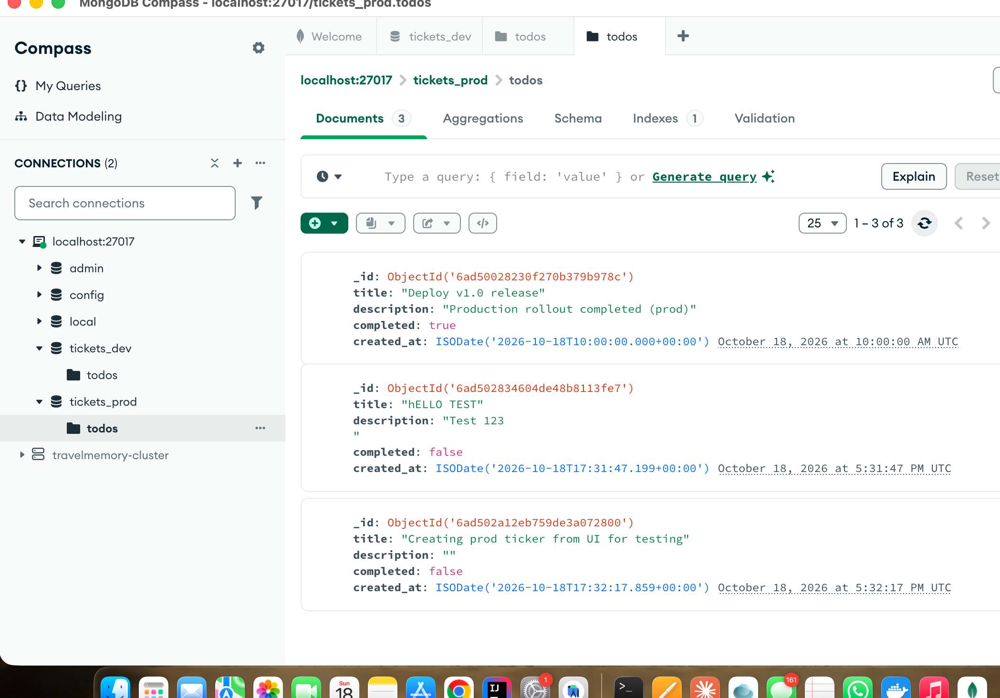

### 6.6 Environment isolation

1. Tickets added in the dev UI (`:3001`) appear in `tickets_dev.todos` (screenshoot#13 to screenshoot#19).
2. Tickets added in the prod UI (`:3002`) appear only at `:3002` and in `tickets_prod.todos` (screenshoot#20 and screenshoot#21).
3. The dev and prod APIs and dashboards show different data (screenshoot#8, 9, 11 and 12).

### 6.7 Inter-service connectivity

Network membership:

```bash
docker network inspect multienvapp_appnet | grep -E "Name|IPv4"
```

```
"Name": "multienvapp_appnet",
    "Name": "frontend",       "IPv4Address": "172.19.0.4/16",
    "Name": "backend-dev",    "IPv4Address": "172.19.0.3/16",
    "Name": "backend-prod",   "IPv4Address": "172.19.0.2/16",
```

Container-to-container requests by service name, from inside the frontend container:

```bash
docker compose exec frontend wget -qO- http://backend-dev:3001/api/tickets
docker compose exec frontend wget -qO- http://backend-prod:3002/api/tickets
```

```
{"tasks": [{"title": "Fix login bug", "description": "Users get 500 error on login (dev)", "completed": true, "created_at": "2026-10-18T10:00:00"}], "environment": "Development"}
{"tasks": [{"title": "Deploy v1.0 release", "description": "Production rollout completed (prod)", "completed": true, "created_at": "2026-10-18T10:00:00"}], "environment": "Production"}
```

All three containers are on `appnet`, and service-name DNS resolves between them. The dev ticket shows `completed: true` because it was marked complete in 6.5.

### 6.8 Database connectivity

Both backends read and write the local MongoDB through `host.docker.internal:27017`. Changes made through the app (add, complete, delete) are visible in Compass in the matching database.

---

## 7. Evidence Index

| Screenshot | What it shows | Section | File                           |
|---|---|---|--------------------------------|
| screenshoot#1 | Compose build, network, containers, `docker compose ps` | 5.1 | `screenshots/screenshoot#1.png` |
| screenshoot#2 | Backend service logs | 5.2 | `screenshots/screenshoot#2.png` |
| screenshoot#3 | Compass: `tickets_dev` and `tickets_prod` | 3.5 | `screenshots/screenshoot#3.png` |
| screenshoot#4 | Frontend home | 6.4 | `screenshots/screenshoot#4.png` |
| screenshoot#5 | Prod API, empty | 6.1 | `screenshots/screenshoot#5.png` |
| screenshoot#6 | Dev API, empty | 6.1 | `screenshots/screenshoot#6.png` |
| screenshoot#7 | Compass prod seed document | 6.2 | `screenshots/screenshoot#7.png` |
| screenshoot#8 | Prod dashboard | 6.4 | `screenshots/screenshoot#8.png` |
| screenshoot#9 | Dev dashboard | 6.4 | `screenshots/screenshoot#9.png` |
| screenshoot#10 | Compass dev seed document | 6.2 | `screenshots/screenshoot#10.png` |
| screenshoot#11 | Prod API with data | 6.3 | `screenshots/screenshoot#11.png` |
| screenshoot#12 | Dev API with data | 6.3 | `screenshots/screenshoot#12.png` |
| screenshoot#13 | Dev backend UI | 6.5 | `screenshots/screenshoot#13.png` |
| screenshoot#14 | Dev UI with ticket added | 6.5 | `screenshots/screenshoot#14.png` |
| screenshoot#15 | Compass: dev ticket added (2 documents) | 6.5 | `screenshots/screenshoot#15.png` |
| screenshoot#16 | Delete confirmation dialog | 6.5 | `screenshots/screenshoot#16.png` |
| screenshoot#17 | Compass: after delete (1 document) | 6.5 | `screenshots/screenshoot#17.png` |
| screenshoot#18 | Dev ticket completed | 6.5 | `screenshots/screenshoot#18.png` |
| screenshoot#19 | Compass: completed true | 6.5 | `screenshots/screenshoot#19.png` |
| screenshoot#20 | Prod backend UI with added tickets | 6.5 | `screenshots/screenshoot#20.png` |
| screenshoot#21 | Compass: prod tickets after add (3 documents) | 6.5 | `screenshots/screenshoot#21.png` |
